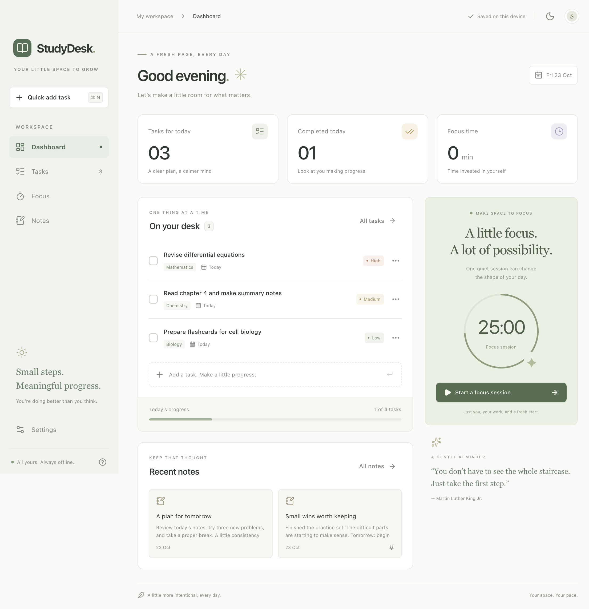

# StudyDesk

A calm, offline home for your study day. StudyDesk is a macOS Electron desktop study planner where students manage tasks, focus with a Pomodoro timer, and capture quick notes. Work stays on the device and survives application restarts. No account or internet connection is needed after installation.

[GitHub repository](https://github.com/abuzarhaideri/StudyDesk) · [Installer and source downloads](https://github.com/abuzarhaideri/StudyDesk/releases/tag/v1.0.0)

[](docs/screenshots/dashboard-retina.png)

*Click the screenshot to open the full-resolution Retina image.*

## Features

- Dashboard with real task counts, today’s completion progress, upcoming work, recent notes and completed focus time.
- Tasks: create, inspect/edit, complete, reopen and delete with confirmation. Description, priority, category, optional due date, timestamps, search, four filters, deadline/priority sorting and quick add.
- Focus: default 25/5/15 minute sessions, custom durations, start/pause/resume/reset/skip, long break every four completed focus sessions, optional automatic breaks, local history and optional native notifications.
- Notes: plain text, immediate autosave with visible status, search, pinning, word count, last-edited time and confirmed deletion.
- Persistent light/dark/system themes, keyboard shortcuts, accessible Radix dialogs, reduced-motion support and layouts down to 860 × 620.
- JSON backup export/import with validation, replacement confirmation and a pre-import backup.

The actual app starts empty. Screenshots containing example work use isolated test profiles.

## Stack and folder structure

Electron 45, React 19, TypeScript, electron-vite 6 / Vite 8, Tailwind CSS 4, local shadcn-style Button/Dialog components built on Radix, Lucide React, Motion, Zod, electron-store 12, electron-builder, Vitest and Playwright’s Electron API. Exact compatible versions are pinned in `package.json` and `package-lock.json`.

```text
frontend/                 React interface, styles, UI primitives
backend/main/             Electron lifecycle, secure IPC, persistence, timer, native dialogs
backend/preload/          Narrow, typed contextBridge API
shared/domain.ts          Validated models and pure task/note/timer operations
tests/unit/               Domain and timer correctness tests
tests/e2e/                Native Electron workflows, recovery and restart tests
build/                    Original icon PNG, ICNS and iconset
scripts/                  Free, local icon generation
docs/                     Screenshots, verification and dependency/cost audit
out/                      Generated production files (ignored by Git)
release/                  Generated app and DMG (ignored by Git)
```

`backend` is Electron’s privileged local process, not a web server. There is no hosted backend or database service. Both frontend and backend are packaged together.

## Install the macOS app

1. Open `release/StudyDesk-1.0.0-arm64.dmg`.
2. Drag **StudyDesk** into **Applications**.
3. Eject the disk image and open StudyDesk from Applications.

This release targets **Apple Silicon (arm64)**. It is locally ad-hoc signed for macOS integrity, with no Apple Developer certificate and no notarization. Gatekeeper may block an app obtained from outside the App Store. For a copy you trust, attempt to open it, then use **System Settings → Privacy & Security → Open Anyway** if offered. Do not disable Gatekeeper globally. No Apple membership or payment is needed. The minimum OS version follows Electron’s current macOS runtime support; the generated bundle’s declared minimum is recorded in `docs/VERIFICATION.md`. Intel packaging is configured as an optional separate command and is not part of the verified arm64 release.

## Develop

Use macOS and **Node 22.12+**. Node 22 is recorded in `.nvmrc`.

```sh
nvm use
npm ci
npm run dev
```

The postinstall script downloads the free Electron runtime. Installation and packaging may require internet access to fetch npm/Electron build tools. The installed app itself does not.

```sh
npm run typecheck
npm run lint
npm test
npm run build
npm run test:e2e
npm start
```

E2E tests require an interactive macOS desktop. They launch the real Electron app using Playwright’s Electron automation API and create a fresh temporary userData directory per test. The tests never change regular user data. They cover CRUD, filters/search, autosave, themes, timer controls/settings, backups, restart persistence, recovery, invalid IPC and minimum-window overflow. A main-process clock offset tests live expiry without waiting a full minute. Native file selections are stubbed while the real import/export handlers operate on temporary files. macOS notification delivery depends on system settings and is not automatically asserted.

## Build an installer

```sh
npm run dist:mac
# Optional Intel release (requires its own validation):
npm run dist:mac:intel
```

electron-builder packages production files in ASAR, generates the DMG with the StudyDesk icon and Applications drag target, and uses free local ad-hoc signing. No certificates or paid signing service are configured. Output is under `release/`.

To rerun the same desktop suite against the packaged application:

```sh
STUDYDESK_EXECUTABLE="$PWD/release/mac-arm64/StudyDesk.app/Contents/MacOS/StudyDesk" npm run test:e2e
```

Regenerate the original icon with `sh scripts/generate-icon.sh` (Python standard library, macOS `sips` and `iconutil`). In restricted sandboxes, `iconutil` needs normal macOS execution permissions.

## Data, recovery and privacy

Main-process electron-store writes JSON atomically to:

```text
~/Library/Application Support/StudyDesk/studydesk.json
```

Tasks, notes, settings, theme, focus history and active timer state share a versioned, Zod-validated store. The renderer cannot access arbitrary files or Node APIs. Saves are acknowledged only after the local store write returns. Notes persist on each edit, with no debounce window to flush on quit. A single-instance lock prevents concurrent applications overwriting the same profile. Data is plain text, not encrypted; use the macOS account and disk protections appropriate to your device. Export backups from Settings.

If the JSON is malformed or fails schema validation, StudyDesk preserves the exact original as `studydesk.json.damaged-<timestamp>.bak` before creating a new empty profile and displaying a recovery notice. Backup failure stops recovery instead of silently deleting data. Importing validates the backup and preserves the previous file as `.before-import-<timestamp>.bak`.

### Timer policy

The main process uses a saved deadline, not a decrementing counter. Pausing saves remaining time; resuming sets a new deadline. Minimized windows do not control completion. Closing/quitting while running lets the deadline continue. On reopening or waking, an expired focus session is recorded once at its deadline, and the next session is left ready to start. No missed focus sessions are invented. Automatic breaks start only while the app is live, and never automatically start another focus session. Reset/skip/mode changes discard partial sessions after confirmation. Settings changes affect the next session, preserving a running session’s duration. Active focus segments separate paused time and allocate completed minutes correctly across local midnight.

The timer follows the system wall clock; manually changing the Mac’s clock can change when it expires. Completed sessions count toward focus statistics; partial sessions do not.

## Security and offline operation

Context isolation and renderer sandboxing are enabled; Node integration is disabled. The bridge exposes only `load`, validated `dispatch`, state subscription, and native backup actions. Main validates IPC sender identity and each mutation. Remote requests, renderer navigation, popups and webviews are blocked. The production CSP allows bundled scripts/assets and excludes remote executable content. Permission requests from web content are denied. Notifications use Electron’s native notification API. No remote fonts, analytics, authentication, AI APIs or update service are included.

## Free tools and MCP

Context7 and Playwright MCP were registered with the official Codex CLI method and verified by starting both servers through the MCP SDK. Context7 was used for library documentation. Playwright MCP attached to an isolated Electron window over local CDP, inspected its accessibility snapshot, captured an empty-dashboard screenshot and reported zero console errors/warnings. The native E2E suite uses Playwright directly and remains independent of MCP availability.

```sh
codex mcp add context7 -- npx -y @upstash/context7-mcp
codex mcp add playwright -- npx -y @playwright/mcp@latest
codex mcp list
```

New servers may need a new Codex session to appear as tools. Context7 was used without a paid API key. If free documentation access becomes unavailable, use the official library documentation. MCP servers are developer tools and are not bundled with or required by the installed app.

## Cost and licenses

Additional required service cost: **₹0**. There is no backend hosting, paid API, paid font, template, database, subscription, signing membership, billing integration or recurring operational service. All dependencies are open source. The app icon is original locally generated artwork, and typography uses system fonts. See `docs/DEPENDENCIES.md` for direct dependency licenses and the audit. Optional npm funding links are not fees. Existing developer computer/network/Codex access are assumed; this project does not call a model API or purchase credits.

## Verification and known limitations

See `docs/VERIFICATION.md` for actual test/build/DMG checks, architecture, packaged-app results and remaining limits. Source is hosted at [abuzarhaideri/StudyDesk](https://github.com/abuzarhaideri/StudyDesk); the installer and submission ZIP are release assets rather than Git-tracked binaries. No cloud sync, collaboration, rich text, accounts or auto-updater are included. The local JSON design is intended for a modest student dataset; writes serialize the dataset, so extremely large notebooks are outside its intended scale.

## Academic submission

Submit the source repository (including lockfile, tests, README, AGENTS, original icon assets and screenshots), `release/StudyDesk-1.0.0-arm64.dmg`, and `docs/VERIFICATION.md`. Exclude `node_modules`, temporary profiles, test reports and build caches. `docs/VERIFICATION.md` records a checksum so the installer can be identified.

Clone the repository (GitHub access is required while it is private):

```sh
git clone https://github.com/abuzarhaideri/StudyDesk.git
cd StudyDesk
npm ci
npm run dev
```

Push future local commits using the configured remote:

```sh
git push -u origin main
```

The repository is MIT licensed; third-party components retain their own licenses.
